<div align="center">

# MediCare

**A private hospital and pharmacy on one platform.**
Book treatments, order medicines, and manage everything from a single admin panel.


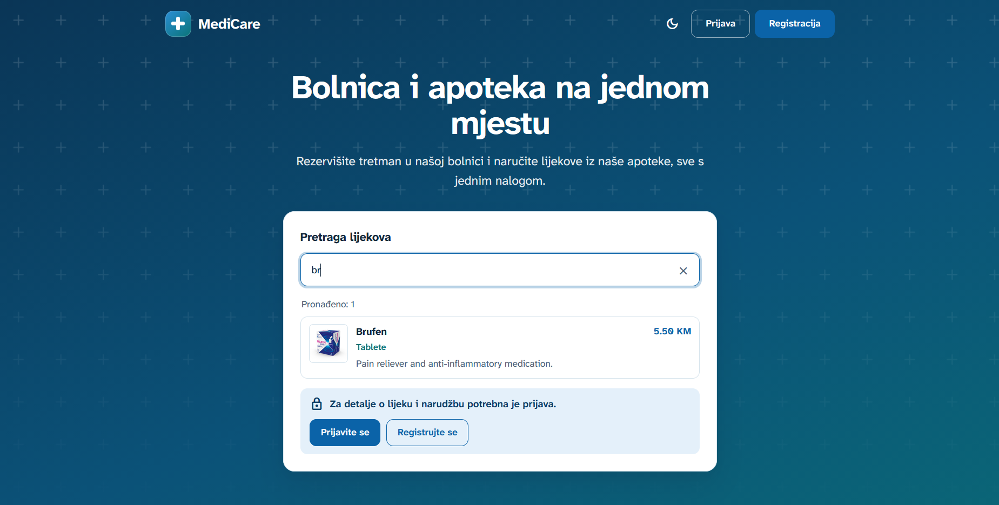

</div>

---

## Table of contents

- [About](#about)
- [Features](#features)
- [Screenshots](#screenshots)
- [Tech stack](#tech-stack)
- [Architecture](#architecture)
- [Getting started](#getting-started)
- [Configuration](#configuration)
- [Demo accounts](#demo-accounts)
- [API overview](#api-overview)
- [Design system and accessibility](#design-system-and-accessibility)
- [Authors](#authors)

---

## About

MediCare is a full-stack web application for a private hospital that also runs its own pharmacy.
Patients can browse and order medicines, and reserve hospital treatments by choosing a day and a free time slot.
Administrators manage the catalogue, orders and reservations, and see the business at a glance on a statistics dashboard.

The project was built as a seminar assignment for the course **Razvoj softvera 1 (RS1)**,
Faculty of Information Technologies, Univerzitet „Džemal Bijedić“ u Mostaru, 2025/26.

The interface is available in **Bosnian** and **English**, in a **light** and a **dark** theme, and works on phones, tablets and desktops.

## Features

### For visitors
- Landing page with a **full-text medicine search** (typo tolerant, works with and without č, ć, š, ž, đ).
- Registration and login (JWT access token + rotating refresh token).

### For patients
- **Pharmacy:** browse medicines, filter by category, search, open a product page with a zoomable photo.
- **Cart, favourites and "save for later"**, and one-click checkout into an order.
- **Hospital:** browse treatments and **reserve an appointment** in an interactive calendar. Taken slots are disabled in real time, and you can add a note for the doctor.
- **Orders:** list of your orders with a clear status (draft, confirmed, paid, completed, cancelled) and a details view.
- **AI assistant** that suggests medicines and treatments from the real catalogue, finds free appointments and can add a medicine to the cart.
- Settings: language and light / dark theme.

### For administrators
- **Medicines:** create, edit, delete, enable / disable, upload an image, and **edit price, name, category and weight inline** by double-clicking a row.
- **Treatments** and **both category catalogues** (medicine and treatment categories).
- **Orders:** filter by status, search, change status, view details, download a **PDF per order** and a **parameterised PDF report** (period + status, with totals).
- **Statistics dashboard:** revenue, orders, reservations, new users and low-stock medicines, with charts for revenue by month, orders by status, best sellers, and reservations by treatment and weekday. Every chart can be shown as a table.
- **AI assistant** for operational questions (who is booked today, order backlog, low stock, last month's revenue). It only reads data.

### Under the hood
- Role-based access (**Admin** and **User**) enforced by route guards in the UI and by authorisation on the API.
- Rate limiting on sensitive endpoints (login, registration, search, orders, assistant).
- Validation with FluentValidation, structured logging with Serilog, API documentation with Swagger.
- Switchable search engine: **Lucene.Net** (default, runs inside the API), plain **SQL**, or **Elasticsearch**.
- Optional push notifications through Firebase Cloud Messaging.

## Screenshots

### Public area

| Landing page with live search | Login |
|:--:|:--:|
|  | 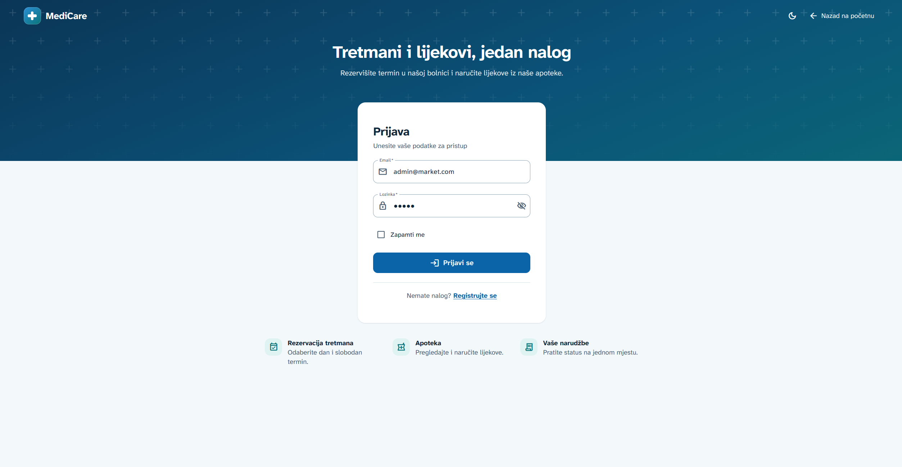 |

### Pharmacy

<p align="center">
  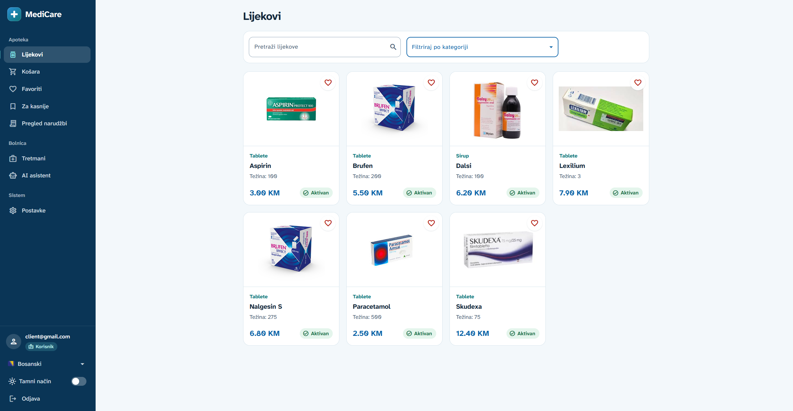<br>
  <em>Medicine catalogue with search and category filter</em>
</p>

| Product page | Cart and order summary |
|:--:|:--:|
| 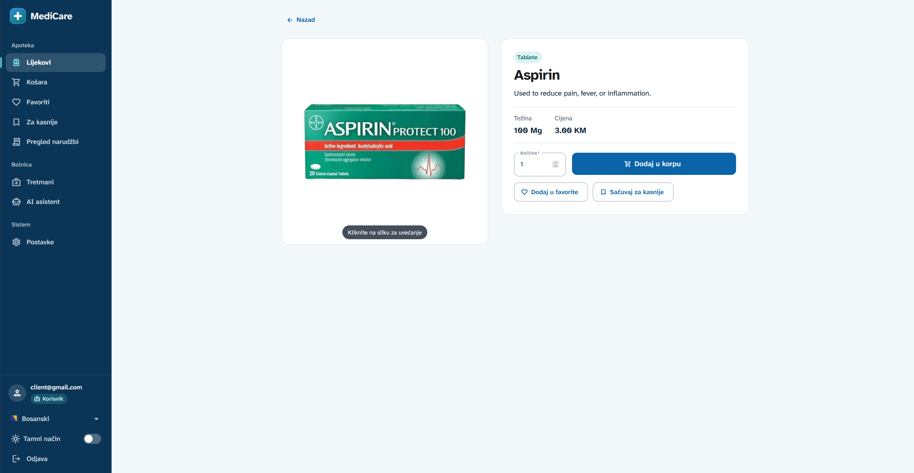 | 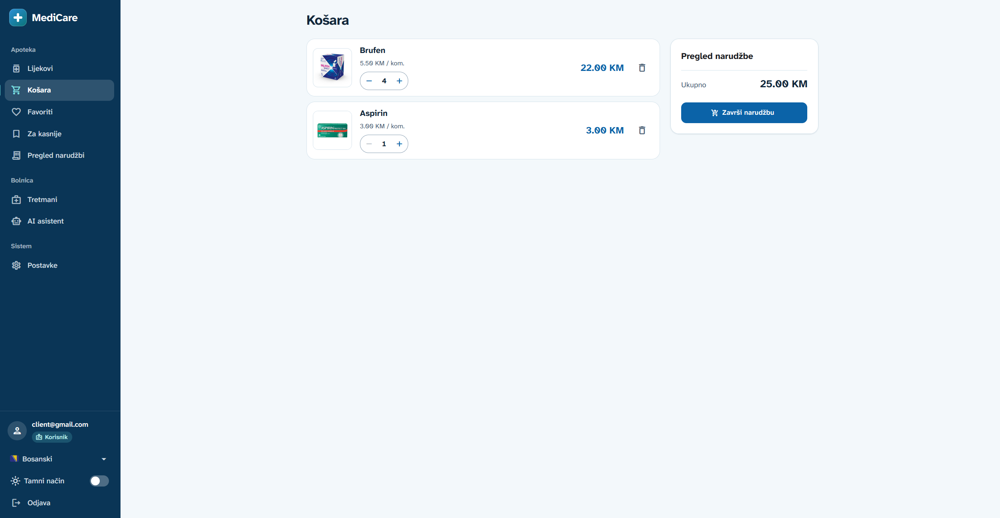 |

### Hospital

<p align="center">
  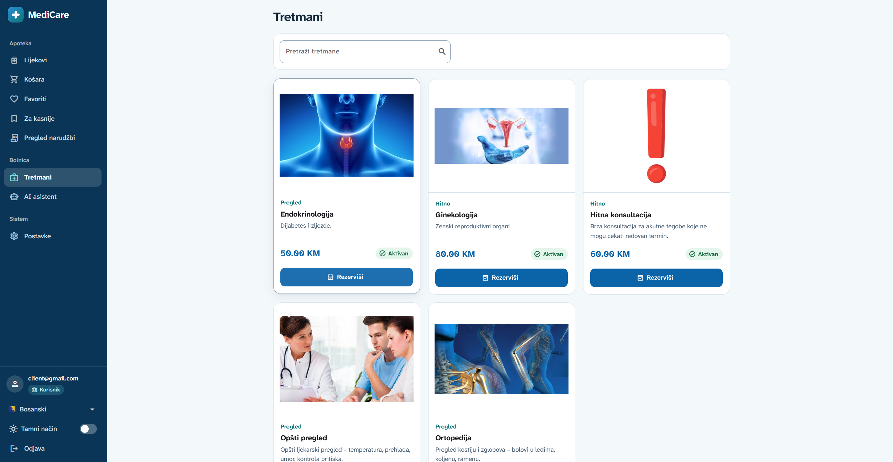<br>
  <em>Treatments with a one-click "Reserve" action</em>
</p>

<p align="center">
  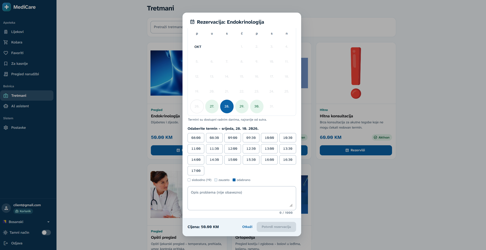<br>
  <em>Booking calendar: pick a day, then a free time slot (taken slots are struck through and disabled)</em>
</p>

| My orders | Order details |
|:--:|:--:|
| 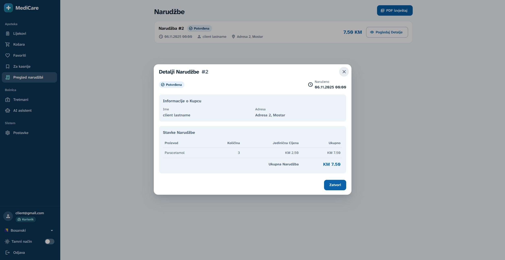 |  |

### AI assistant

<p align="center">
  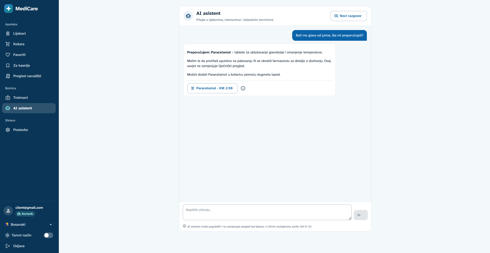<br>
  <em>The assistant answers from the real catalogue and can act on the patient's behalf (add to cart, book)</em>
</p>

### Administration

<p align="center">
  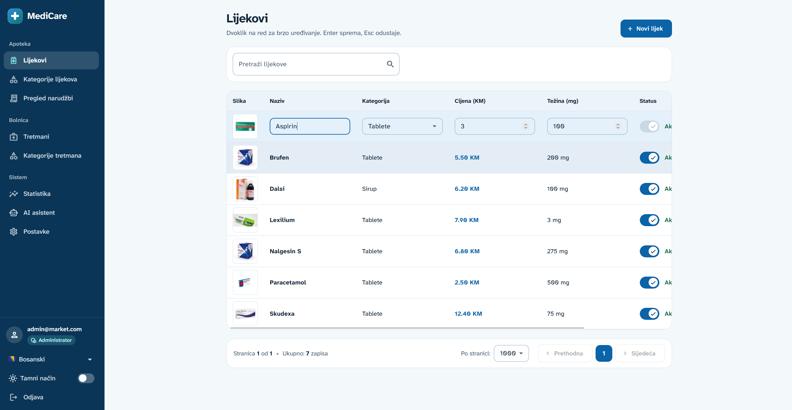<br>
  <em>Medicines: double-click a row to edit it in place</em>
</p>

<p align="center">
  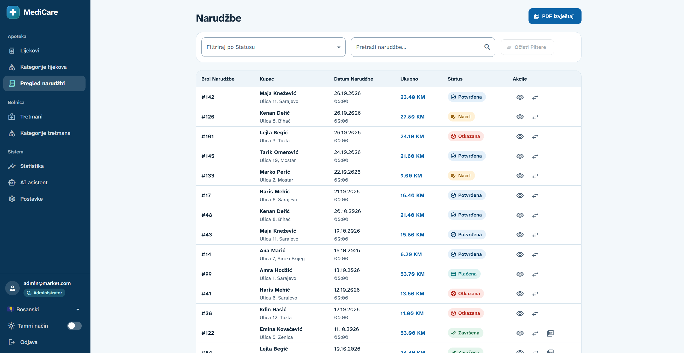<br>
  <em>Orders: filters, status changes, details and PDF export</em>
</p>

<p align="center">
  <br>
  <em>Statistics dashboard</em>
</p>

| PDF report dialog | Generated PDF |
|:--:|:--:|
| 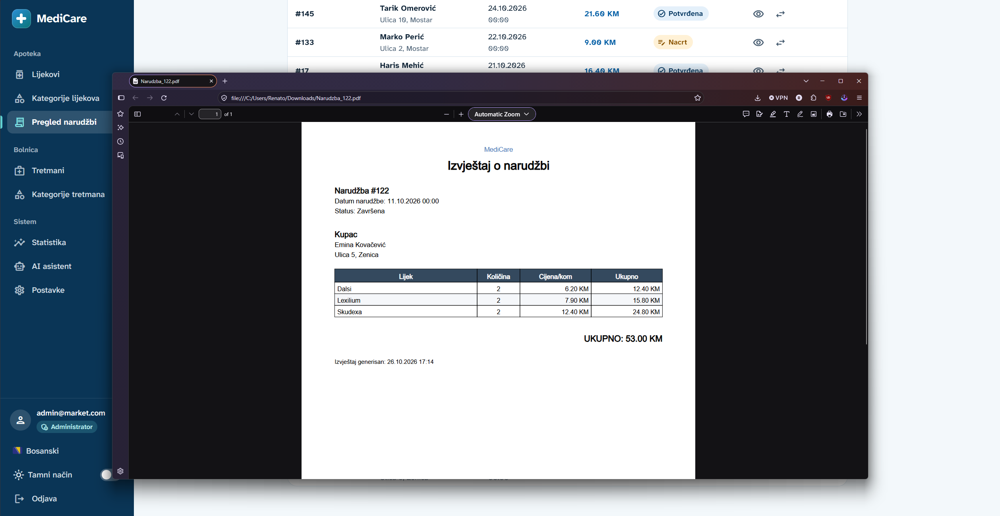 |  |

<p align="center">
  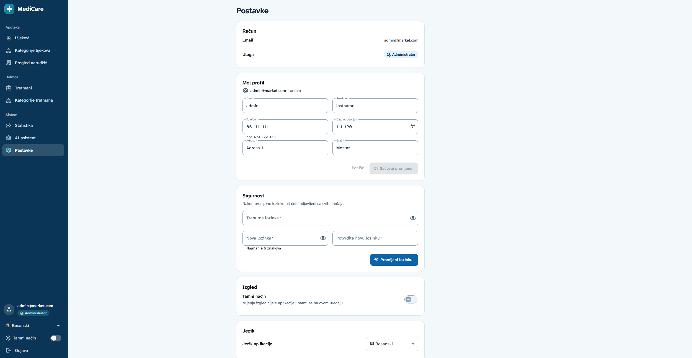<br>
  <em>Settings: account, theme and language</em>
</p>

### Dark mode and mobile

<p align="center">
  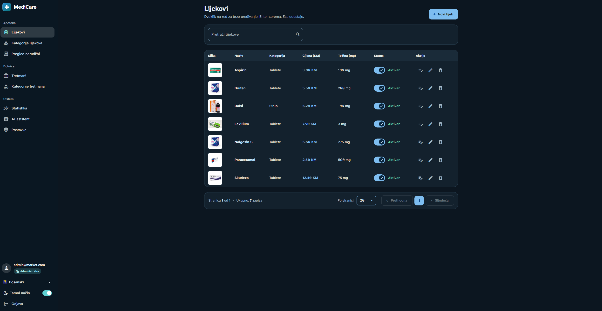<br>
  <em>One setting for the whole app, remembered on the device</em>
</p>

<p align="center">
  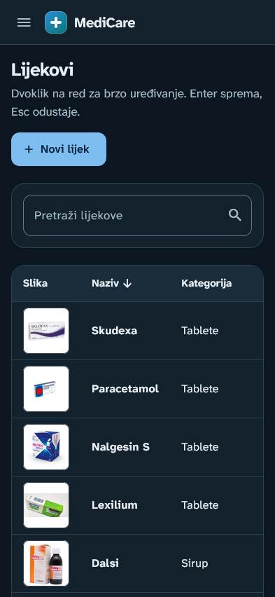
  &nbsp;&nbsp;
  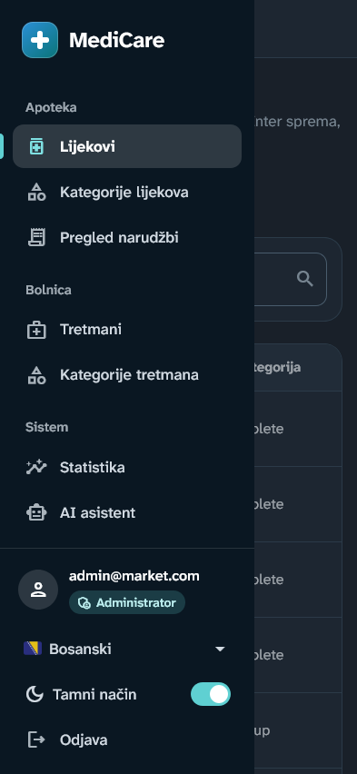
</p>

### API documentation

<p align="center">
  
</p>

## Tech stack

| Layer | Technologies |
|---|---|
| **Backend** | C#, ASP.NET Core (.NET 8), Entity Framework Core 8, MediatR (CQRS), FluentValidation, Serilog, Swagger / Swashbuckle |
| **Database** | Microsoft SQL Server (code-first migrations, automatic seeding in Development) |
| **Auth** | JWT bearer tokens, rotating refresh tokens (stored hashed), role-based authorisation |
| **Search** | Lucene.Net 4.8 (default) · SQL fallback · Elasticsearch (optional) |
| **Documents** | iTextSharp (PDF per order and parameterised PDF report) |
| **AI** | Groq chat completions (OpenAI-compatible API) with read-only tools over the catalogue and, for admins, business data |
| **Frontend** | Angular 21, Angular Material 21, RxJS, signals, ngx-translate (bs / en), Chart.js, jwt-decode |
| **Push** | Firebase Cloud Messaging (optional) |

## Architecture

```
Angular SPA ──HTTP/JSON──▶ ASP.NET Core API ──▶ MediatR handlers ──▶ EF Core ──▶ SQL Server
 (guards, interceptors)     (controllers,          (validation,        (soft delete,
                             rate limiting,         business logic)      audit fields)
                             JWT, Swagger)
```

The backend follows a layered, CQRS-style structure. Controllers stay thin and send a command or query through MediatR;
a validation pipeline runs before every handler, and handlers hold the business logic.

```
MediCare/
├─ MediCare.Backend/
│  ├─ MediCare.API/             Controllers, middleware, rate limiting, Program.cs
│  ├─ MediCare.Application/     Use cases (Modules/*: commands, queries, DTOs, validators)
│  ├─ MediCare.Domain/          Entities
│  ├─ MediCare.Infrastructure/  EF Core, migrations, seeders, JWT, search, AI client
│  ├─ MediCare.Shared/          Options and shared contracts
│  └─ MediCare.Tests/
└─ MediCare.Frontend/rs1-frontend-2025-26/
   ├─ public/                   Self-hosted fonts, i18n (bs.json, en.json)
   └─ src/
      ├─ styles/                Design system (tokens, shell, pages, admin)
      └─ app/
         ├─ core/               Guards, interceptors, auth, theme service
         ├─ api-services/       One typed service per backend resource
         └─ modules/            public · auth · client · admin · shared (lazy loaded)
```

## Getting started

### Prerequisites

- [.NET 8 SDK](https://dotnet.microsoft.com/download)
- [Node.js](https://nodejs.org/) LTS (20.19+ or 22.12+) and npm
- Microsoft SQL Server (Express, Developer or LocalDB)
- Visual Studio 2022 is recommended for the backend, but the .NET CLI is enough

### 1. Clone

```bash
git clone https://github.com/RenatoAntunovic/MediCare.git
cd MediCare
```

### 2. Configure the database

Open `MediCare/MediCare.Backend/MediCare.API/appsettings.json` and point `ConnectionStrings:Main` to your SQL Server:

```json
"ConnectionStrings": {
  "Main": "Server=localhost\\SQLEXPRESS;Database=MediCare;Trusted_Connection=True;MultipleActiveResultSets=true;TrustServerCertificate=True"
}
```

You do not need to create the database or run migrations by hand. In the **Development** environment the API
applies all migrations and seeds demo data on startup.

### 3. Run the backend

**Visual Studio:** open `MediCare/MediCare.Backend/MediCare.Backend.sln`, set **MediCare.API** as the startup project and press **F5**.

**Terminal:**

```bash
dotnet dev-certs https --trust        # one time: trust the local HTTPS certificate
cd MediCare/MediCare.Backend/MediCare.API
dotnet run --urls "https://localhost:7260;http://localhost:5177"
```

The API listens on `https://localhost:7260` and Swagger is at `https://localhost:7260/swagger`.

### 4. Run the frontend

```bash
cd MediCare/MediCare.Frontend/rs1-frontend-2025-26
npm install
npm start
```

Open **http://localhost:4200**. The dev server proxies API calls to `https://localhost:7260`, so **start the backend first**.

### 5. Optional: AI assistant

The assistant is disabled until it has an API key (the rest of the app works without it).
Create a free key at [console.groq.com](https://console.groq.com) and store it in user secrets, never in `appsettings.json`:

```bash
cd MediCare/MediCare.Backend/MediCare.API
dotnet user-secrets set "Groq:ApiKey" "gsk_your_key_here"
```

## Configuration

| Key (`appsettings.json` / user secrets) | Purpose | Default |
|---|---|---|
| `ConnectionStrings:Main` | SQL Server connection string | `localhost\SQLEXPRESS`, database `MediCare` |
| `Jwt:Key`, `Jwt:Issuer`, `Jwt:Audience` | Token signing. Use your own secret outside development | development values |
| `Jwt:AccessTokenMinutes`, `Jwt:RefreshTokenDays` | Token lifetimes | see file |
| `Search:Provider` | `Lucene` (in-process, default), `Sql`, or `Elasticsearch` | `Lucene` |
| `Elasticsearch:*` | Only when `Search:Provider` is `Elasticsearch` (server must be running) | none |
| `Groq:ApiKey` | Enables the AI assistant | not set |
| `Groq:Model`, `Groq:BaseUrl` | Assistant model and endpoint | `openai/gpt-oss-120b`, Groq OpenAI-compatible URL |

**Search.** With `Lucene` the index lives in memory and is rebuilt from the database on every start; it is kept in sync automatically when medicines change.
After renaming a category, restart the API (or call `POST /api/sync/sync-medicines` as an admin) so search results pick up the new name.

**PDF fonts.** PDFs need a font with Croatian / Bosnian letters (č ć đ š ž). On Windows the generator uses Arial automatically.
On macOS / Linux, place `DejaVuSans.ttf` in `MediCare.API/wwwroot/fonts/`.

## Demo accounts

Created by the seeder in the Development environment. Change or remove them before any real deployment.

| Role | Email | Password |
|---|---|---|
| Admin | `admin@market.com` | `Admin` |
| User | `client@gmail.com` | `test123` |

## API overview

All endpoints are documented in Swagger. Main groups:

| Area | Examples |
|---|---|
| **Auth** | `POST /api/auth/login`, `/register`, `/refresh`, `/logout` |
| **Pharmacy** | `/api/Medicine`, `/MedicineCategories`, `/api/Cart`, `/api/Favourites`, `/api/ForLater` |
| **Hospital** | `/api/Treatments`, `/TreatmentCategories`, `/api/Reservations`, `GET /api/Reservations/availability` |
| **Orders** | `/Orders`, `PUT /Orders/{id}/change-status`, `GET /Orders/{id}/pdf`, `GET /Orders/report/pdf` |
| **Search** | `GET /api/search?query=...`, `POST /api/sync/sync-medicines` (admin) |
| **Assistant** | `POST /api/assistant/chat` |
| **Statistics** | `GET /api/statistics/dashboard` (admin) |
| **Account** | `/api/profile` (view, update, change password), `/api/notifications/token` |

## Design system and accessibility

The whole interface is built on one set of design tokens (`src/styles/`): colour, type, shape and spacing are defined once,
and **dark mode** switches the same tokens, so no page has its own theme code.

- Typeface: **Atkinson Hyperlegible Next**, designed for maximum legibility, self-hosted together with the icon font (no third-party requests).
- Text and controls meet **WCAG AA contrast**, with large click targets (48 px), visible keyboard focus and labelled form fields.
- Status is never shown by colour alone: every badge pairs a colour with an icon and a word.
- Layouts adapt to phones, tablets and desktops (the sidebar becomes an overlay on small screens), and animations respect the "reduce motion" setting.

## Authors

- [@RenatoAntunovic](https://github.com/RenatoAntunovic)
- [@namikomerovic](https://github.com/namikomerovic)
